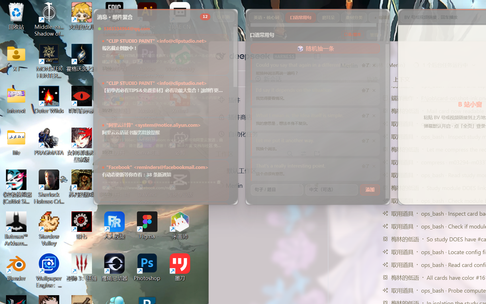

# Pico RamOS · 重点代码

一个 Windows 桌面卡片系统。屏幕不是一堆窗口，而是一张可以摆卡片的桌面：应用、网页、模块、宠物、B 站、文件夹、邮件，各自是一张卡，拖动、叠放、收起。

私有的全量仓库保存完整工程与配置，这里是可读的核心部分。

## 结构

```
src/
  main.js            Electron 主进程：窗口创建、托盘、全局快捷键、卡片 IPC
  preload.js         渲染进程桥梁，只暴露白名单方法
  modules/           功能模块：邮件、歌单、天气、笔记等
  shell/             桌面外壳：卡片渲染、布局、拖拽、主题
  manager/           卡片管理器：增删、排序、分组
  scene-dock.*       场景停靠条
  scene-toast.*      通知气泡
  wizard/            首次启动的引导
  pet/               桌面宠物（含一个 3D 模型）
  tools/             构建与调试脚本
```

## 设计取舍

卡片是唯一的数据单位。一张卡记着 `kind`（app / web / module / pet / bili / folder / mail）、位置、尺寸、所属分组。渲染层只认这几种 kind，因此新增一类卡片不需要改布局代码。

外壳与卡片分离。`shell/` 负责摆，`modules/` 负责内容，两者通过 IPC 通信。这样换掉外壳不影响模块。

本地优先。邮件模块直连 IMAP，歌单直连本地播放器接口，没有中间服务器。

## 运行

```
npm install
npm start
```

需要 Windows 10 以上，Node 18+。

## 截图


